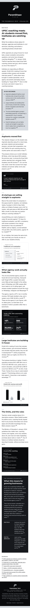

# Parambhaav Newsletter Generator

Give it one topic and it produces a researched, branded email newsletter with infographics, saved as a **Gmail draft** for review. Each issue covers how a technology is used around the world, then closes with **what it means for Indian businesses**.

Built by Parambhaav Tech (Bengaluru) with [Claude Code](https://claude.com/claude-code), using the **WAT framework** (Workflows · Agent · Tools).

<p align="center">
  
</p>

## What it does

| Step | Output |
|---|---|
| 🔍 **Research** | Web research where every fact, number and quote is tied to a source URL. Dead or unopened links are flagged. |
| ✍️ **Write** | The issue in Parambhaav's brand voice: subject, intro, 3–5 sections and a closing section for Indian businesses |
| 📊 **Infographics** | Stat cards, charts, timelines, comparisons and quote cards as brand-coloured PNGs, plus at most one AI illustration |
| ✅ **Check** | Automated checks on citations, numbers, brand voice, colours, contrast, logo size and the Gmail size limit |
| 📬 **Deliver** | A Gmail draft with inline images. Nothing is sent without explicit human approval. |
| 📒 **Archive** | One row per issue in a Google Sheet |

Sample outputs are in [docs/images/](docs/images/).

## How it's built (the WAT framework)

```
workflows/   WHAT to do: plain-English SOPs (steps, rules, edge cases, learnings)
Agent        WHO decides: Claude Code reads the workflow, runs the tools, checks output, fixes problems
tools/       HOW it's done: small deterministic Python scripts, one job each
config/      Brand rules (colours, fonts, voice, Indian market angle) and recipients
```

AI handles judgment; scripts handle execution. More detail, including who checks what, the quality bar and the roadmap, is in [docs/ARCHITECTURE.md](docs/ARCHITECTURE.md).

## Pipeline

```
topic
 → tools/research_topic.py        research.json   (Groq web search; or the agent researches in session)
 → tools/write_newsletter.py      content.json    (Groq; or the agent writes in session)
 → tools/check_content.py         citations, numbers traced to research, brand voice, India takeaway
 → tools/render_infographics.py   img/*.png       (Playwright + Chart.js; Cloudflare Workers AI for the AI image)
 → tools/build_newsletter.py      newsletter.html + preview.png  (runs tools/brand_check.py)
 → tools/send_via_gmail.py        Gmail draft  (--send only after approval)
 → tools/archive_to_sheets.py     Google Sheets log
```

The full SOP is in [workflows/generate_newsletter.md](workflows/generate_newsletter.md).

## Setup

**Requirements:** Python 3.10+ and Linux, macOS or WSL.

```bash
python3 -m venv .venv
.venv/bin/pip install -r requirements.txt
.venv/bin/playwright install chromium
cp .env.example .env                                  # then fill in your keys
cp config/recipients.example.json config/recipients.json
.venv/bin/python tools/prepare_brand_assets.py        # email-sized logos
```

| Service | What for | Cost | Setup |
|---|---|---|---|
| Groq | Research and writing | Free tier | Key from console.groq.com/keys → `GROQ_API_KEY` |
| Cloudflare Workers AI | AI illustration | Free tier | Account ID + Workers AI API token → `.env` |
| Google Cloud | Gmail drafts, Sheets archive | Free | Enable the Gmail, Sheets and Drive APIs, create a **Desktop** OAuth client, and save it as `credentials.json`. The first run opens a browser for consent. |

> While the OAuth app is in **Testing** mode, add every Google account that will sign in as a **test user** (Google Auth Platform → Audience).

## Usage

The easiest way is to open the folder in Claude Code and say:

> "Create a newsletter on *AI in Indian real estate*"

The agent follows the workflow and returns a Gmail draft link. To run the steps by hand:

```bash
S=.tmp/<slug>
.venv/bin/python tools/research_topic.py "AI in Indian real estate"
.venv/bin/python tools/write_newsletter.py $S/research.json
.venv/bin/python tools/render_infographics.py $S/content.json
.venv/bin/python tools/build_newsletter.py $S/content.json
.venv/bin/python tools/send_via_gmail.py $S/content.json          # creates the draft
.venv/bin/python tools/archive_to_sheets.py $S/content.json
```

## Quality rules (non-negotiable)

- Every claim and number comes from a verified source. No rounding, combining or extrapolating.
- Chart numbers must appear in the research; the check flags any that don't.
- India-specific claims need an Indian source. Currencies stay as the source states them.
- No hype words or guaranteed-result claims.
- **Drafts only.** Sending to the list requires explicit human approval.

## Known limitations

- Groq's research has twice returned dead links and fabricated quotes. For niche or India-specific topics, research in a Claude Code session instead.
- Gmail is fine for drafts and small lists. For client newsletters, use an email service (Brevo, Mailchimp or Zoho Campaigns) for unsubscribes, tracking and deliverability.
- The agent loop currently runs inside Claude Code. Unattended runs need the Claude Agent SDK or LangGraph (see the roadmap in [docs/ARCHITECTURE.md](docs/ARCHITECTURE.md)).

## Docs

- [docs/ARCHITECTURE.md](docs/ARCHITECTURE.md): framework, roles, quality checks, LangGraph analysis, turning it into a skill, roadmap
- [docs/SELLING.md](docs/SELLING.md): how to package and sell this to clients
- [workflows/generate_newsletter.md](workflows/generate_newsletter.md): the operating SOP and learnings log

## Security

Never commit `.env`, `credentials.json`, `token.json` or `config/recipients.json`; all are git-ignored. Each client gets their own keys, Google sign-in and recipient list.
